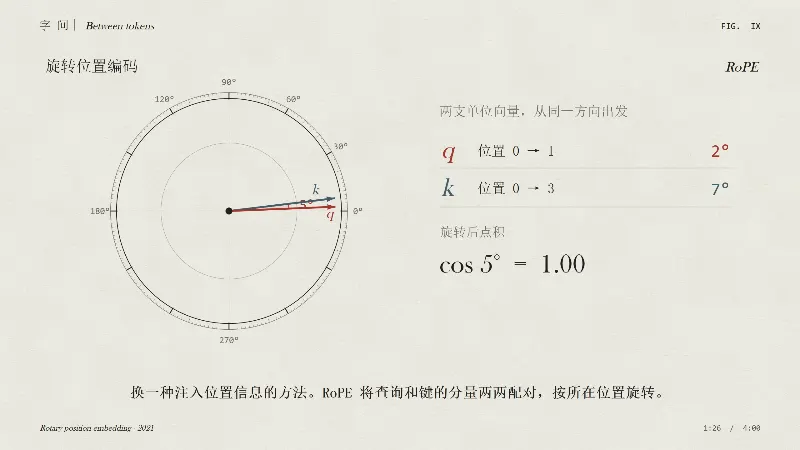

# 字间 · Transformer

一部由网页逐帧绘制的中文深度学习短片。镜头跟着「小猫 / 坐在 / 垫子 / 上」中的一个位置，先算清注意力如何分配，再走进前馈层、编码器和解码器。后半段用同一套视觉语言讲 RoPE、FlashAttention、核化线性注意力、KV 缓存与分组查询注意力。

**成片为 4:00，2560 × 1440，60 fps，含中文字幕与原创双声道音效。**

[下载 MP4 单独包](https://github.com/ayasecastorice-maker/transformer-in-motion/releases/download/v1.0.0/transformer-in-motion-v1.0.0-mp4.zip) · [下载完整项目包](https://github.com/ayasecastorice-maker/transformer-in-motion/releases/download/v1.0.0/transformer-in-motion-v1.0.0-full.zip) · [下载离线网页版](https://github.com/ayasecastorice-maker/transformer-in-motion/releases/download/v1.0.0/transformer-4min-web.zip) · [SHA-256 校验](https://github.com/ayasecastorice-maker/transformer-in-motion/releases/download/v1.0.0/SHA256SUMS)



## 怎么看

想直接看成片，解压 MP4 单独包即可。想逐帧研究，解压离线网页版，用浏览器打开 `index.html`，点击播放或从菜单跳到指定镜头。完整包另外保留了 36 秒原型、2:30 和 2:56 两版成片、各阶段的网页包、字幕、原始音轨、开发截图、编码样片与验证记录。[按时间查看 20 个镜头与教学算例](feature/README.md)

## 制作思路

1. **先做能算清楚的分镜。** 全片从同一个四词例句出发。先让观众看到「坐在」给「垫子」分配了 45.5% 的权重，再拉远到整张矩阵，看到反向读取只有 21.5%。动画中的数字由教学算例得到。[注意力可视化代码](feature/attention-lab.js)
2. **让一次运动对应一次计算。** 点积用配对和累加，多头用分屏和拼接，RoPE 用两根转针。FlashAttention 镜头把四个数分成两块，观众能看到第二块如何改写旧的分子和分母。纸纹、墨点、刻线和朱红高亮都由 Canvas 2D 绘制。[分块计算镜头](feature/flash.js)
3. **网页预览与视频使用同一条时间线。** 每一帧由帧号和镜头局部时间决定。拖动到同一帧，字幕、粒子和矩阵回到同一状态。程序合成的声轨按相同切点安排脉冲和转场，播放时由音轨时钟驱动画面。[时间线](feature/timeline.js) · [声音合成](feature/score.js)
4. **逐帧导出，再从成片解码验证。** Node.js 通过 Playwright 驱动本机浏览器，逐帧读取原生画布。WebCodecs 编码 H.264 与 AAC，分批写盘后封装 MP4。验证脚本读取视频时间表、解码审片帧与音轨，并抽检连续的 1/60 秒画面。[导出与验证说明](feature/tools/README.md)

## 从哪里开始改

| 想修改 | 文件 |
| --- | --- |
| 镜头顺序、字幕、画幅和帧率 | [feature/timeline.js](feature/timeline.js) |
| 注意力和前馈运算的表现方式 | [attention-lab.js](feature/attention-lab.js)、[plates.js](feature/plates.js) |
| RoPE、线性注意力和推理缓存 | [rope.js](feature/rope.js)、[linear.js](feature/linear.js)、[inference.js](feature/inference.js) |
| 编码器和解码器的布局、连线 | [architecture.js](feature/architecture.js) |
| 对照早期原型和设计过程 | [36 秒原型](prototype/README.md)、[开发截图](development-stills/) |

播放离线包只需要浏览器。重新导出需要 Node.js、Playwright 和支持 WebCodecs H.264/AAC 的桌面浏览器。正式制作和验证环境为 Windows + Chrome。在仓库根目录运行以下命令，先试编 6 秒，再导出全片和截图。大型视频及历史压缩包在上述 Release 中。

```sh
npm install --prefix . --no-save --package-lock=false playwright-core
node feature/tools/render.cjs --sample
node feature/tools/render.cjs --all
```

画面参考了 Kimi K3 预告的墨字、纸面和版画表达。片中的插图、字幕和音效为本项目制作。原片可从发布者处观看。[视觉参考](https://x.com/Kimi_Moonshot/status/2081757327146045450) · [Transformer 原始论文](https://arxiv.org/abs/1706.03762)

